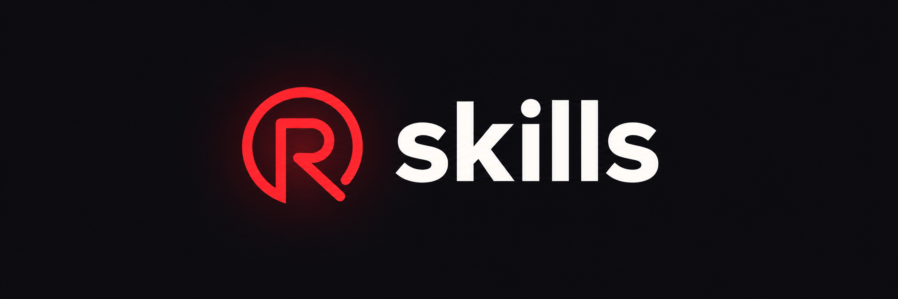

# Rundesk Skills

**Practical workflows for your coding agent.** Debug a stubborn issue, design an interface, research
a market, or build a game with reusable guidance for the job.

This open-source catalog contains **71 standalone skills across 8 categories**, plus **4 review
subagents**. Pick the skills your project needs and use them with an agent that supports `SKILL.md`.

**[Get Rundesk →](https://rundesk.app/)** · [Find a skill](#find-a-skill) ·
[Get started](#get-started) · [Latest release](https://github.com/rundesk-ai/skills/releases/latest)

## What is a skill?

A skill is a set of written instructions your agent can load for a particular kind of work. It
provides a process to follow, pitfalls to avoid, and ways to check the result. Supporting references
give the agent more detail when it needs it.

For example, a debugging skill guides the agent through reproducing a failure and finding its cause.
A testing skill helps it choose meaningful cases and assertions. A research skill gives it a method
for evaluating sources and supporting its conclusions.

- **Choose what fits.** Each skill works on its own, with no other skills required.
- **Keep your workflow.** The files are plain Markdown that you can read and adapt.
- **Start without integrations.** The skills themselves need no account, API key, or connected service.

Your agent still needs the tools and access required for the task itself.

## Find a skill

Start with what you want to accomplish:

| I want to… | Start here |
|---|---|
| Fix a bug or understand a failure | [Debugging code](skills/development/debugging-code/) |
| Add useful tests or improve a test suite | [Testing code](skills/development/testing-code/) |
| Review changes before shipping | [Reviewing code](skills/development/reviewing-code/) |
| Design a usable interface | [UI and UX](skills/design/designing-ui-ux/) |
| Build a landing page | [Landing pages](skills/design/designing-landing-pages/) |
| Understand an audience or market | [Customer research](skills/research/researching-customers/) · [Market research](skills/research/researching-markets/) |
| Make a game | [Game design](skills/games/game-design/) · [Player experience](skills/games/game-player-experience/) |
| Work in a specific language or framework | [Languages and stacks](#languages-and-stacks) |

After installation, ask your agent for the work in ordinary language. For example:

> Find out why this test fails, reproduce the cause, and verify a fix.

An agent that supports skill discovery can select a relevant skill from its description. How to
request a skill explicitly depends on your agent.

## Get started

### Manage your skills with Rundesk

[**Rundesk**](https://rundesk.app/) brings your coding agents, terminals, prompts, schedules, and
skills together across projects. Use its skill library to choose what each project gets and keep
installed skills up to date.

1. **[Get Rundesk](https://rundesk.app/)** and add your project folder.
2. **Add a skill package** in Rundesk's Settings using this repository URL:

   ```text
   https://github.com/rundesk-ai/skills
   ```

3. **Choose skills from the library** and add them to your project.

Rundesk installs the package from its newest release tag and checks for package updates on launch.
When the package updates, projects using its skills receive the new versions.

**[Explore Rundesk →](https://rundesk.app/)**

### Install manually

You can also use these skills without Rundesk:

1. Download the source archive from the [latest release](https://github.com/rundesk-ai/skills/releases/latest).
2. Choose a skill under `skills/<category>/`.
3. Copy its **entire folder**, including its references, into the skills directory your agent reads,
   such as `.agents/skills/` or `.claude/skills/`.

For example, copying `skills/development/debugging-code/` into `.agents/skills/` gives you:

```text
your-project/
└── .agents/
    └── skills/
        └── debugging-code/
            ├── SKILL.md
            └── references/
```

Follow your agent's instructions for discovering newly installed skills. Use a release rather than
`main` for installation; `main` may contain unreleased changes. Manual copies need to be updated
manually when you want a newer version.

## Explore the catalog

Expand a category to browse its skills. Each link opens the skill's instructions and references.

<details>
<summary><strong>Development · 7 skills</strong> — Debug, test, review, improve performance, and deliver work.</summary>

- [Debugging code](skills/development/debugging-code/)
- [Engineering performance](skills/development/engineering-performance/)
- [Managing development work](skills/development/managing-development-work/)
- [Managing GitHub](skills/development/managing-github/)
- [Naming software terms](skills/development/naming-software-terms/)
- [Reviewing code](skills/development/reviewing-code/)
- [Testing code](skills/development/testing-code/)

</details>

<details>
<summary><strong>Design · 6 skills</strong> — Shape interfaces, visual assets, documents, APIs, and data models.</summary>

- [APIs](skills/design/designing-apis/)
- [Visual assets](skills/design/designing-assets/)
- [Databases](skills/design/designing-databases/)
- [Landing pages](skills/design/designing-landing-pages/)
- [PDFs](skills/design/designing-pdfs/)
- [UI and UX](skills/design/designing-ui-ux/)

</details>

<details>
<summary><strong>Writing · 8 skills</strong> — Turn ideas into posts, copy, tickets, plans, and agent instructions.</summary>

- [Advertising copy](skills/writing/writing-advertising-copy/)
- [Agent instructions](skills/writing/writing-agent-instructions/)
- [Blog posts](skills/writing/writing-blog-posts/)
- [Bug tickets](skills/writing/writing-bug-tickets/)
- [Implementation plans](skills/writing/writing-implementation-plans/)
- [Skills](skills/writing/writing-skills/)
- [Social content](skills/writing/writing-social-content/)
- [Task tickets](skills/writing/writing-task-tickets/)

</details>

<details>
<summary><strong>Research · 4 skills</strong> — Investigate questions, customers, competitors, and markets.</summary>

- [Competitors](skills/research/researching-competitors/)
- [Customers](skills/research/researching-customers/)
- [Markets](skills/research/researching-markets/)
- [Topics and fact-checking](skills/research/researching-topics/)

</details>

<details>
<summary><strong>Marketing · 3 skills</strong> — Improve a shop, search visibility, and lead-compliance workflows.</summary>

- [Ecommerce](skills/marketing/marketing-ecommerce/)
- [Lead compliance](skills/marketing/marketing-lead-compliance/)
- [Search visibility](skills/marketing/marketing-search-visibility/)

</details>

<details>
<summary><strong>Games · 19 skills</strong> — Design gameplay, create worlds, and build the systems behind them.</summary>

- [2D art](skills/games/game-2d-art/)
- [2D rendering](skills/games/game-2d-rendering/)
- [3D models](skills/games/game-3d-models/)
- [Agent behavior](skills/games/game-agent-behavior/)
- [Animation](skills/games/game-animation/)
- [Cameras and controls](skills/games/game-cameras-and-controls/)
- [Game design](skills/games/game-design/)
- [Isometric worlds](skills/games/game-isometric-worlds/)
- [Levels](skills/games/game-levels/)
- [Management simulations](skills/games/game-management-sims/)
- [Pathfinding](skills/games/game-pathfinding/)
- [Player experience](skills/games/game-player-experience/)
- [Runtimes](skills/games/game-runtimes/)
- [Tile worlds](skills/games/game-tile-worlds/)
- [Traffic](skills/games/game-traffic/)
- [Unreal UI](skills/games/game-unreal-ui/)
- [Unreal worlds](skills/games/game-unreal-worlds/)
- [World generation](skills/games/game-world-generation/)
- [World simulations](skills/games/game-world-simulations/)

</details>

<details>
<summary><strong>Media · 2 skills</strong> — Direct character images and video with visual continuity.</summary>

- [AI video](skills/media/directing-ai-video/)
- [Character images](skills/media/directing-character-images/)

</details>

### Languages and stacks

<details>
<summary><strong>Stacks · 22 skills</strong> — Guidance for the languages, frameworks, databases, and tools you use.</summary>

- **Languages:** [C++](skills/stacks/using-cpp/) · [C#](skills/stacks/using-csharp/) · [GDScript](skills/stacks/using-gdscript/) · [JavaScript and TypeScript](skills/stacks/using-javascript/) · [PHP](skills/stacks/using-php/) · [Python](skills/stacks/using-python/) · [Rust](skills/stacks/using-rust/)
- **Web:** [Django](skills/stacks/using-django/) · [Inertia](skills/stacks/using-inertia/) · [Laravel](skills/stacks/using-laravel/) · [React](skills/stacks/using-reactjs/) · [Tailwind CSS](skills/stacks/using-tailwindcss/) · [Vue and Nuxt](skills/stacks/using-vuejs/)
- **Databases:** [MySQL](skills/stacks/using-mysql/) · [PostgreSQL](skills/stacks/using-postgres/) · [SQLite](skills/stacks/using-sqlite/)
- **Desktop:** [Electron](skills/stacks/using-electron/) · [Tauri](skills/stacks/using-tauri/)
- **Games and 3D:** [Axmol](skills/stacks/using-axmol/) · [Blender](skills/stacks/using-blender/) · [Godot](skills/stacks/using-godot/) · [Unreal Engine](skills/stacks/using-unreal-engine/)

</details>

## Review subagents

The catalog also includes four focused reviewers. Skills guide an agent's work; subagents define a
separate reviewer you can delegate a task to in an agent CLI that supports them.

| Subagent | Use it for |
|---|---|
| [Code quality reviewer](subagents/code-quality-reviewer.md) | Auditing existing code for bugs, convention violations, and improvements worth making. |
| [Simplicity reviewer](subagents/dry-simplicity-reviewer.md) | Finding duplication, redundant logic, and unnecessary complexity. |
| [Senior code reviewer](subagents/senior-code-reviewer.md) | Reviewing completed changes for defects, security issues, and regressions. |
| [Test coverage auditor](subagents/test-coverage-auditor.md) | Finding meaningful coverage gaps without writing tests or changing code. |

Rundesk installs the package's subagents into its subagent library and makes them available to
supported agent CLIs while its subagents setting is enabled. For manual setup, follow your CLI's
subagent format and configuration instructions.

## How the catalog is organized

Each skill lives in `skills/<category>/<name>/`. Its `SKILL.md` describes when to use it and the
workflow to follow; `references/` contains supporting guidance and sources.

[`manifest.json`](manifest.json) is the package index used by the Rundesk app and Rundesk CLI.
It lists every skill and subagent in the catalog.

## Contribute

Found a gap or something that could work better? [Open an issue](https://github.com/rundesk-ai/skills/issues)
or propose a change. Read [AGENTS.md](AGENTS.md) first, change skills in this repository, then run:

```sh
./scripts/check.sh
./tests/run.sh
```

## Licence

This catalog is [MIT licensed](LICENSE). Adapted material retains its own licence; see
[third-party notices](THIRD_PARTY_NOTICES.md) and the relevant skill's `references/sources.md`.
